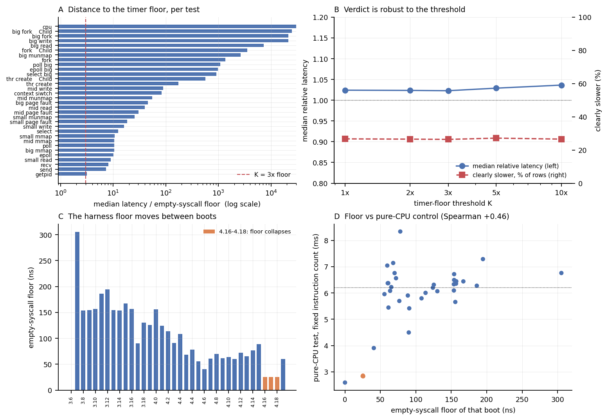

# Timer-resolution audit of the kernel sweep

**Reporter:** 孙东旭 (5260000073)
**Input:** `results/kernel_summary.csv` (36 booted kernels, 33 tests, three runs each)
**Script:** `analysis/timer_floor.py` — every number below is printed by it
**Figure:** `analysis/fig_timer_floor.png`
**Row-level output:** `analysis/suspect_rows.csv`

---

## Why this audit exists

The commit of 2026-11-03 (`5260000157 邹浩宇`, *time getpid in a batch*) showed that
a single-shot `getpid` measures mostly the cost of reading the clock. If that is
true, some rows in `results/kernel_summary.csv` may be measuring the harness
rather than the kernel, and the verdict on claim 1 could be resting on them.

This note answers three questions with the data already in the repository:

1. How many measurements are actually timer-bound?
2. Does removing them change the verdict?
3. Is the harness overhead even constant between boots?

---

## Method

* The **floor** of a boot is the latency of `ref`, the empty syscall. It is what
  the harness costs when the kernel does almost nothing.
* A measurement is **timer-bound** if its mean is below `K × floor`. Default
  `K = 3`: below that, the clock path contributes a share of the number that is
  comparable to the effects being compared.
* A reading of exactly zero is treated as a failed window, not a fast kernel.
* The verdict is recomputed on the surviving rows for `K ∈ {1, 2, 3, 5, 10}` so
  that the choice of threshold is shown, not asserted.

---

## F1. Only 4.9% of the rows are timer-bound, and the verdict does not move

| Quantity | Value |
| --- | --- |
| measurements | 1152 |
| usable at `K = 3` | 1096 (95.1%) |
| timer-bound or invalid | 56 (4.9%) |

The 56 rows are **not spread evenly**:

| Reason | Rows | Where |
| --- | --- | --- |
| floor is zero (broken batch) | 32 | the entire `3.6.10` boot (floor 0 ns) |
| within 3× of the floor | 24 | 16 × `getpid`, 2 × `send`, 2 × `small read`, and one each of `epoll`, `mid mmap`, `recv`, `big mmap`, `small mmap` |

`getpid` is the only test that is systematically close to the floor: its median
is only **3.1×** the floor, and it clears `K = 3` on just 19 of 36 kernels. Every
other test sits at 7× (`send`) to 59 000× (`cpu`).

Removing the 56 rows does **not** change the verdict:

| K | rows used | median ratio | ≥50% higher | clearly slower | clearly faster |
| --- | --- | --- | --- | --- | --- |
| 1× | 1120 | 1.024 | 17.7% | 26.7% | 14.8% |
| 2× | 1116 | 1.023 | 17.7% | 26.5% | 14.9% |
| **3×** | **1096** | **1.023** | **18.0%** | **26.4%** | **14.9%** |
| 5× | 1046 | 1.029 | 18.8% | 27.2% | 14.4% |
| 10× | 908 | 1.036 | 17.7% | 26.5% | 13.8% |

Across a 10× range of the threshold the median ratio stays within 1.023–1.036 and
the share of clearly-slower rows within 26.4–27.2%. **The "the numbers are just
timer noise" objection does not explain the flat verdict.** That is a useful
negative result: it removes a mundane explanation.



---

## F2. The floor is not a constant — it moves by an order of magnitude between boots

| Boot | floor (ns) | Note |
| --- | --- | --- |
| `3.6.10` | **0** | broken batch; all 32 of its rows are unusable |
| `3.7.9` | **305** | 2× the usual floor; 7 rows look timer-bound because of it |
| `3.12.8` | 195 | |
| `4.0.5` | 156 | the paper's baseline kernel |
| `4.6.4` | 41 | |
| `4.16–4.18` | **25–26** | see F3 |
| `4.20.13` | 60 | |

An empty syscall should not cost 0 ns on one boot and 305 ns on another. The
floor is a property of the boot (host load, frequency, timer), not of the kernel.
Two consequences:

* absolute latencies are not comparable across boots — only **ratios computed
  within one boot** are safe, which is what the sweep already reports;
* a whole batch can be invalid (`3.6.10`) and should be dropped rather than
  averaged in.

---

## F3. The 4.16–4.18 "speedup" is a boot artifact — confirmed by a fixed-work control

`analysis-note.md` (§F4) flagged 4.16–4.18 as an unexplained step change: every
test appeared about twice as fast, with an unusually small CV. The floor data
identifies the cause.

| Kernel | `ref` floor | pure-CPU test | `getpid` | `fork` | `big write` | `big munmap` |
| --- | --- | --- | --- | --- | --- | --- |
| 4.14.15 | 77 ns | 5.69 ms | 535 ns | 109 µs | 1.77 ms | 206 µs |
| 4.15.15 | 89 ns | 5.90 ms | 248 ns | 142 µs | 2.55 ms | 212 µs |
| **4.16.13** | **25 ns** | **2.85 ms** | **100 ns** | **59 µs** | **0.66 ms** | **84 µs** |
| **4.17.14** | **25 ns** | **2.84 ms** | **100 ns** | **60 µs** | **0.61 ms** | **84 µs** |
| **4.18.16** | **26 ns** | **2.83 ms** | **100 ns** | **64 µs** | **0.67 ms** | **79 µs** |
| 4.20.13 | 60 ns | 7.04 ms | 230 ns | 183 µs | 2.27 ms | 193 µs |

The **pure-CPU test** — a fixed-size compute loop with no syscall, no I/O and the
same instruction count on every kernel — is **2× faster** on those three boots.
A kernel cannot make a fixed loop run twice as fast on identical hardware, and a
microbenchmark that calls the kernel zero times cannot be affected by kernel
code. So the step change is in the **time base or the CPU frequency of those
boots**, not in Linux 4.16 through 4.18.

Across all 36 boots, the floor and the pure-CPU control move together
(Spearman **+0.46**): when a boot's floor collapses, its whole batch looks
faster. Panel D of the figure shows this directly.

**Rule that follows:** a boot whose pure-CPU control deviates from the median by
more than a few percent must be excluded from any cross-kernel comparison. That
is three boots here (4.16, 4.17, 4.18) — 99 of the 1152 rows, 8.6%.

---

## What to change in the harness

1. **Record the pure-CPU control in `environment.txt` for every batch.** It is
   the cheapest artifact detector available: one number per boot, and it caught
   the largest anomaly in the dataset.
2. **Record `scaling_cur_freq` and the `cpufreq` governor** with each batch.
   That would say directly what F3 had to infer.
3. **Drop rows where `floor == 0` or `mean < 3 × floor`** before summarising.
   The list is already produced: `analysis/suspect_rows.csv`, column `usable`.
4. **Never compare absolute nanoseconds across boots.** Compare ratios within a
   boot (the sweep already does this; the report should say so explicitly).

---

## Limitations

* The floor is measured once per boot (the `ref` test), so it is itself a
  three-sample estimate; the values with large stdev (`3.17.6`: 90 ± 57 ns,
  `4.0.5`: 156 ± 64 ns) are correspondingly weak.
* `K = 3` is a judgement call. It is defended by the sensitivity table in F1,
  not by first principles.
* The pure-CPU control shows *that* the time base moved, not *which* mechanism
  (frequency, turbo, clocksource). Answering that needs the frequency and
  governor records listed above.

## Reproduce

```bash
python3 analysis/timer_floor.py --csv results/kernel_summary.csv --outdir analysis
```
